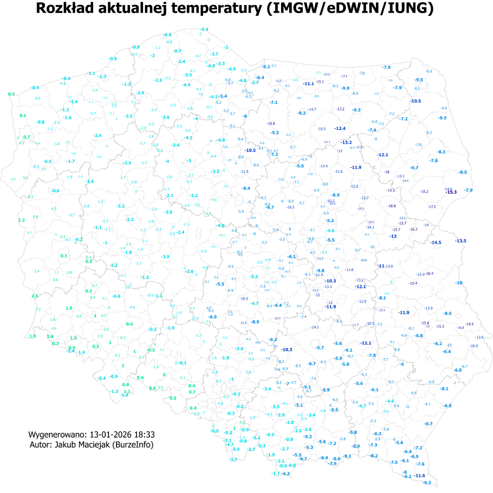
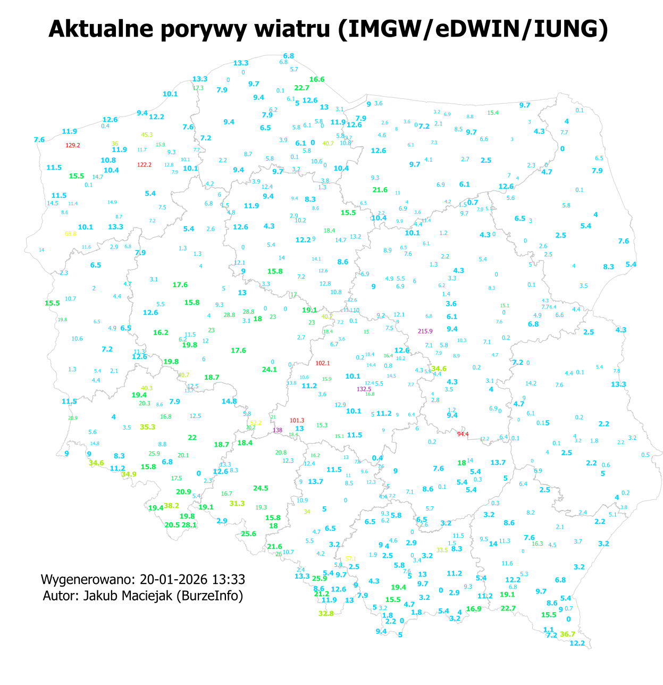
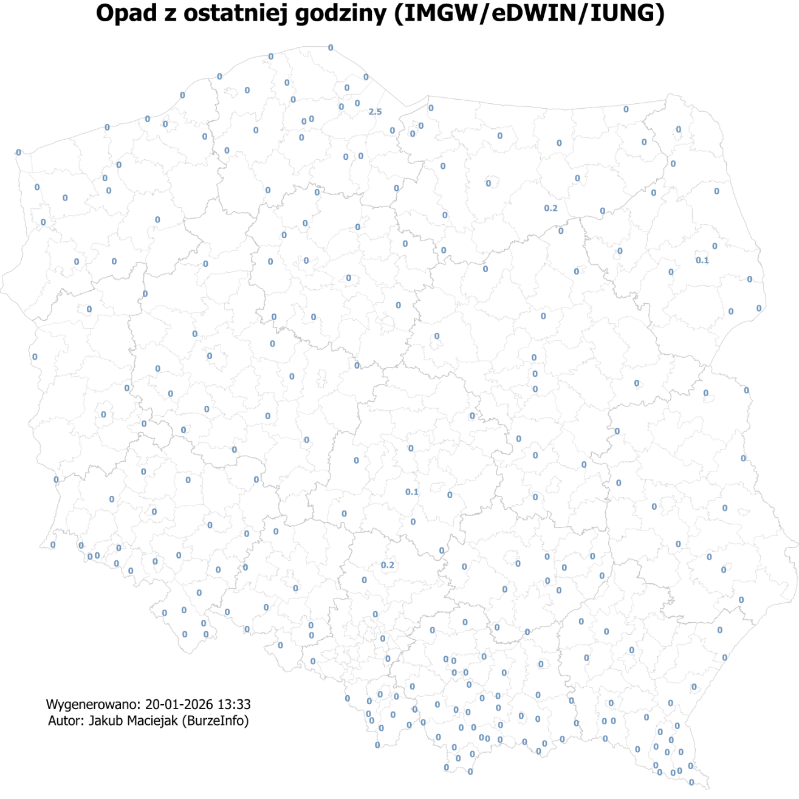

# Weather Data Harmonisation with FME & Python

**An academic ETL project integrating weather observations from IMGW, eDWIN and IUNG station networks across Poland.**

Developed for the **Spatial Data Analysis and Harmonisation** course at Wrocław University of Science and Technology. The project combines FME workflows with embedded Python scripts to collect, standardise and merge data, generate reports and create maps.

**Author:** Jakub Maciejak · [GitHub](https://github.com/Maciejuu) · [LinkedIn](https://www.linkedin.com/in/jakub-maciejak-3aa280277/)

## Project overview

Weather station networks publish observations in different structures, units and update intervals. Station identifiers and location information also vary between sources.

The aim was to create a consistent dataset for analysis, reporting and GIS visualisation. The work included collecting measurements and station metadata, joining records, harmonising attributes, applying basic quality rules and exporting the results.

## Tools and skills

- **FME Workbench:** designing and parameterising an ETL workflow.
- **Python / PythonCaller:** data collection, processing, integration with FME objects and report generation.
- **APIs and web scraping:** working with JSON and HTML using Requests and Selenium.
- **Data quality:** measurement-time filtering, range checks, missing values and duplicate handling.
- **Spatial processing:** station georeferencing, coordinate transformations and enrichment with administrative and elevation data.
- **Outputs:** CSV, Shapefile, TXT reports and PNG maps.

## Data sources

| Source | Role |
|---|---|
| IMGW | Weather and precipitation observations, collected partly through a third-party website; the official API also supports station identification and location checks. |
| eDWIN | Agrometeorological observations and station metadata accessed through an API. |
| IUNG / ASTER-Meteo | Observations from station websites, linked to locations stored in `metadane_IUNG.csv`. |
| PRG | Administrative boundaries used to assign province, county and municipality attributes. |
| GUGiK / digital terrain model | Terrain elevation used to enrich station metadata. |

Sources referenced in the project report: [third-party IMGW data website](https://rafalraczynski.com.pl/dane-imgw/), [official IMGW API](https://danepubliczne.imgw.pl/api/data/meteo/), [eDWIN](https://www.edwin.gov.pl/dane-agrometeorologiczne), [eDWIN API](https://www.edwin.gov.pl/meteo-api) and [IUNG station website](https://meteor.iung.pulawy.pl/view.php?s=1).

## Workflow

1. **Extract:** collect observations and station metadata through separate branches for IMGW, eDWIN and IUNG.
2. **Join:** match measurements to stations using identifiers or station names and create point geometries.
3. **Harmonise:** align attributes, convert units such as m/s to km/h, round values and transform coordinates.
4. **Validate:** filter observation timestamps against UTC time and replace values outside configured ranges with null values.
5. **Handle duplicates:** for stations shared by eDWIN and IUNG, the documented approach retains eDWIN coordinates and IUNG observations, considered more recent in this project.
6. **Enrich:** optionally add administrative attributes from PRG and terrain elevation from the GUGiK service.
7. **Export:** save datasets, generate text summaries and render maps of station observations.

Transformers found in the workspace include `PythonCaller`, `FeatureJoiner`, `Tester`, `DuplicateFilter`, `HTTPCaller`, `PointOnAreaOverlayer`, `FeatureWriter` and `MapnikRasterizer`.

## Results

The project report describes an integrated temperature dataset covering **approximately 750 stations**, with a broader range of **700–800 stations** depending on observation availability. It also records **184 active IUNG stations** identified during metadata preparation. These are historical figures reported for the project, not verified current network sizes.

| Output | Contents |
|---|---|
| CSV and Shapefile | Individual source datasets and the combined harmonised dataset; optional IMGW precipitation data. |
| PNG maps | Air temperature, wind gusts and precipitation during the previous hour. |
| TXT reports | Station rankings and minimum/maximum values for selected weather variables, including `raportTemperatur.txt`, `raportWiatru.txt` and `raportOpadow.txt`. |

The report gives an indicative runtime of **about two minutes under favourable conditions**. This is not a benchmark or a performance guarantee.

### Example outputs

The images below were extracted from the original report and show historical project results. Labels represent observations at station locations, rather than a continuous interpolated surface. Original Polish labels have been retained.

**Air temperature**

**Wind gusts**

**Precipitation during the previous hour**

Combining the networks improves the spatial coverage of observations and supports reporting across sources. However, the datasets do not have uniform measurement quality. The report notes remaining suspicious values, particularly in wind gust observations.

## Getting started

### Requirements

- FME Workbench with Python support and the transformers used in the workspace. The supplied file was saved in **FME 2025.1.3.3, build 25648**; compatibility with other versions needs checking.
- Internet access to the external data sources.
- Python packages required by the individual `PythonCaller` scripts, including `requests`, `selenium`, `pandas`, `numpy` and `webdriver-manager`.
- Additional input files: **`metadane_IUNG.csv` and PRG boundary data**, for example `PRG.zip`.

Install external packages in the Python environment used by FME. The `datetime` and `re` modules belong to the Python standard library and do not require separate installation. Check browser and driver requirements when using Selenium.

### Run the workspace

1. Open [`projekt.fmw`](projekt.fmw) in FME Workbench.
2. Set the paths to the IUNG metadata file and PRG boundary dataset.
3. Select an output directory and target coordinate system.
4. Choose the datasets and export formats, then enable the required maps and reports.
5. Run the workspace and inspect the log and output files.

| Parameter | Purpose |
|---|---|
| `SourceDataset_CSV2` | IUNG station metadata file. |
| `prgDataset` | PRG administrative boundary dataset. |
| `folder` | Output directory. |
| `coordSyst` | Target coordinate system; the saved configuration uses `EPSG:2180`. |
| `separatedWriterIMGW`, `separatedWriterIMGWrain`, `separatedWriterEDWIN`, `separatedWriterIUNG`, `separatedWriterALL` | Enable export of individual datasets. |
| `IMGWfilestype` | Export formats, such as CSV and Shapefile. |
| `raportTemperature`, `raportWindMax`, `raportRain` | Enable text reports. |
| `top_n_records` | Number of stations included in report rankings; the saved value is 15. |
| `newMetadata`, `newMetadata2` | Metadata enrichment options; inspect their descriptions in Workbench before running. |
| `mapTemperature`, `mapWind`, `mapRain` | Enable map generation. |

**The workspace alone is not a complete reproducibility package.** The IUNG metadata CSV and PRG inputs are not included in the current package and must be supplied separately. Local paths in the workspace need updating. Current source availability and successful execution have not been verified through a new FME run.

## Limitations and possible improvements

- Quality checks use fixed thresholds, such as a temperature range of −40 to +45°C, rather than statistical models or neighbourhood validation.
- Sources differ in measurement quality, completeness and observation times. The rules do not remove all errors.
- Web scraping and API integration depend on external website structures and service availability.
- Scheduled observation archiving, extended historical statistics, temperature interpolation and additional networks are potential improvements discussed in the report, rather than confirmed features of this version.
- Check each provider's terms before redistributing source data or derived datasets.

## Repository files

| Path | Contents |
|---|---|
| `README.md` | Project overview and setup instructions. |
| [`projekt.fmw`](projekt.fmw) | FME workspace, including embedded Python scripts. |
| [`dokumentacjaAiHD_jakubmaciejak.pdf`](dokumentacjaAiHD_jakubmaciejak.pdf) | Original project report in Polish. |
| `assets/temperature.png` | Example temperature map from the report. |
| `assets/wind_gusts.png` | Example wind gust map from the report. |
| `assets/precipitation.png` | Example precipitation map from the report. |

Place the workspace and report alongside this README, and retain the `assets/` directory so the relative links work.

The report identifies the solution as **Alpha 1.0**; the workspace metadata records a later save in FME 2025.1.3.3. This overview is based on the report and static workspace inspection, without a new execution of the workflow.
